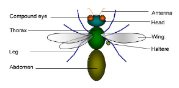
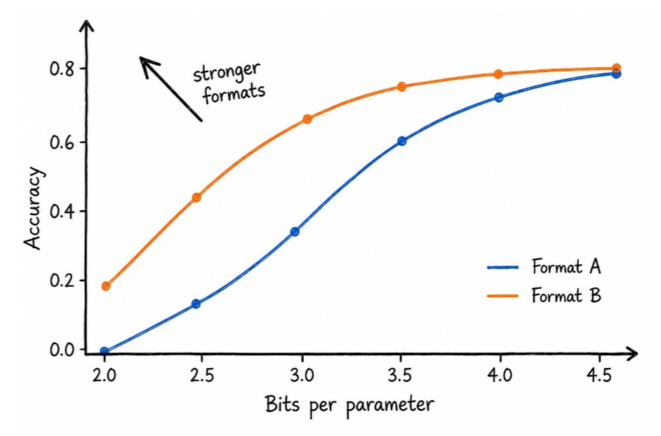
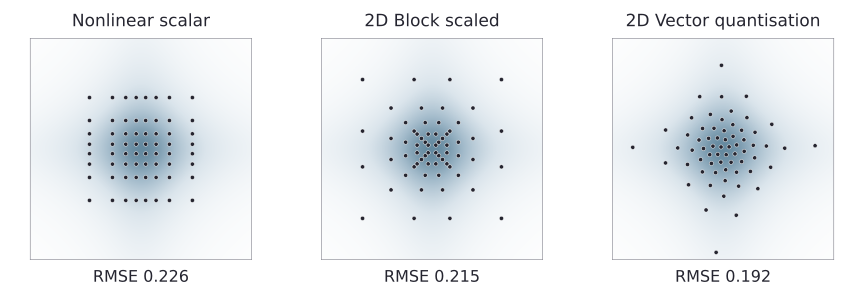
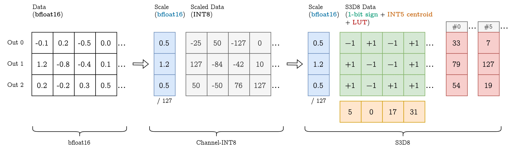
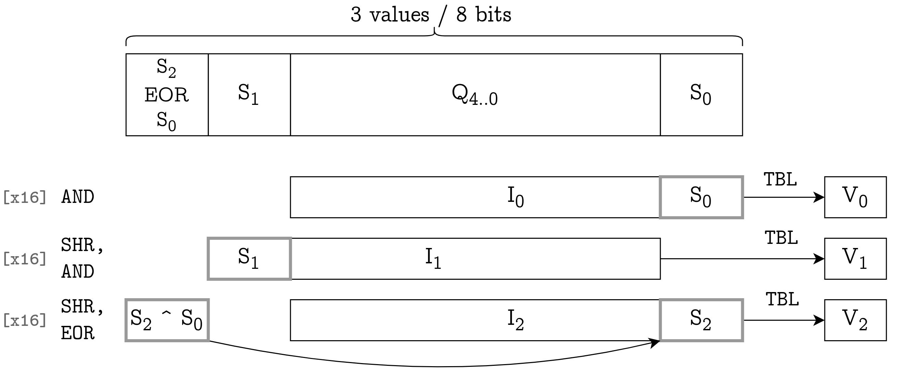
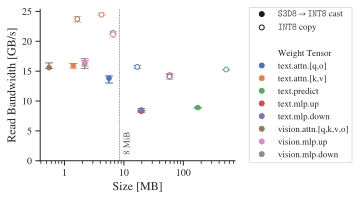
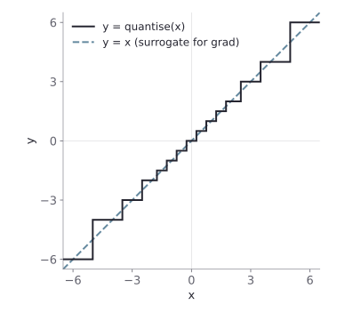
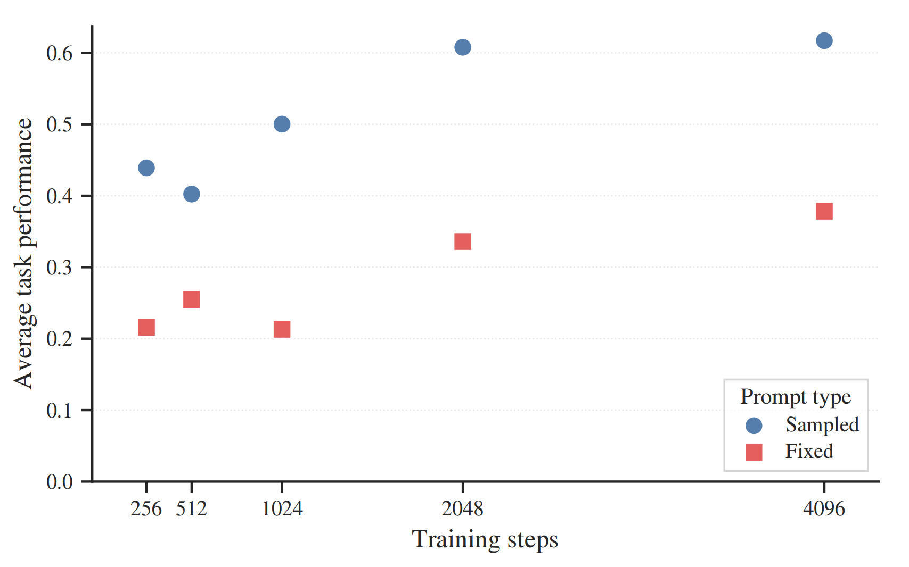
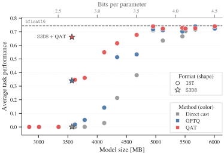

<!-- .slide: class="title-slide" -->

# Llama Mobile

<div class="title-authors">
  <div>Luka Ribar<span class="title-affiliation">Graphcore</span></div>
  <div>Jeevan Bhoot<span class="title-affiliation">Arm</span></div>
  <div>Douglas Orr<span class="title-contact"><a href="mailto:douglaso@graphcore.ai">douglaso@graphcore.ai</a></span><span class="title-affiliation">Graphcore</span></div>
</div>

<p class="title-paper">[<a href="https://arxiv.org/abs/2608.21134">the paper</a>, <a href="https://graphcore-research.github.io/2026-08-24-llama-mobile/#format-decoding-on-arm-cpus">blog</a>]</p>

---

<!-- .slide: class="headline-slide" -->

# Goal: Compress a 11B parameter VLM to ~3.7 GB, for a phone

<div class="headline-content">
<div class="headline-copy" markdown>

Towards this, we expected to work on weight quantization, requiring **high compression** (< 3 bit/parameter) & **fast decoding**.

- _Format-kernel codesign:_ Arm-friendly S3D8 weight format
- _Fine-tuning recipe:_ Multimodal QAT without pretraining data
- _Demo implementation:_ Ground-up Linux/Android Arm CPU inference

</div>
<video controls data-autoplay muted loop playsinline preload="metadata" aria-label="Llama-Mobile Android demo">
  <source src="assets/img/demo.mp4" type="video/mp4">
</video>
</div>

---

# Contents

- Problem setup
- Format design
- Quantisation-aware training
- Results
- Limitations & further work

---

# Problem setup : Vision-Language Models

<div class="left-right-panels">
<div class="left-panel" markdown>

VLMs are LLMs with vision encoders to enable processing both images and text as inputs.

They are a natural fit to mobile deployment!

But, can be large, e.g. Llama 3.2 11B Vision Instruct is 22 GB in bfloat16.

**Model Execution:**

```python
vision_cache = vision_encode(image, vision_params)
text_cache = text_prefill(vision_cache, query, text_params)

# repeatedly...
next_token, text_cache = \
  predict(vision_cache, text_cache, text_params)
```
</div>
<div class="right-panel" markdown>

**Example (AI2D):**



**Query:** Which of these is used for locomotion or support? Options: 1) Antenna, 2) Abdomen, 3) Leg, 4) Head.

**Expected answer:** 3) Leg
</div>
</div>

---

# Problem setup : Quantisation

<div class="left-right-panels" style="grid-template-columns: minmax(0, 56.25fr) minmax(0, 43.75fr)">
<div class="left-panel" markdown>

To reduce model size, we focus on weight quantisation (other approaches include sparsity & distillation).

Three competing objectives:

 1. **Accuracy** - minimise reduction in task performance
 2. **Size** - compress the weights as much as possible
 3. **Speed** - dequantize quickly; ideally next-token-prediction remains memory-bound

</div>
<div class="right-panel">
  <figure>
    
    <figcaption>Illustrative tradeoff analysis between size and accuracy.</figcaption>
  </figure>
</div>
</div>

---

# Format design : Efficient formats

As a side quest during this project, we worked on a paper: [Optimal Formats for Weight Quantisation](https://arxiv.org/abs/2505.12988).<sup>1</sup>

One takeaway from this was that **non-linear scalar formats have an efficiency ceiling**, which matters most at extreme compression and for heavy-tailed data.


<figcaption>Quantisation of IID Student's t (df = 7) data to 3 bits/value. <b>Nonlinear scalar</b>: Fits 2<sup>3</sup> = 8 centroids (plotting the cartesian product). <b>2D block</b>: One 2-bit scale per two 2-bit values. <b>2D vector quantisation</b>: Fits 2<sup>6</sup> = 64 centroids. All scales & centroids are fitted to minimise RMSE.</figcaption>

<p class="footnote"><sup>1</sup> On reflection, the title was a bit of an overshoot.</p>

---

# Format design : Target platform

<div class="left-right-panels" style="grid-template-columns: minmax(0, 55fr) minmax(0, 45fr)">
<div class="left-panel" markdown>

We want to optimise:

```python
output = input @ dequantise(weight).T
```

...on an Android phone with Arm cores (e.g. Pixel 8a).

Since it has the `i8mm` extension, a fast baseline dot product reads `weight` directly as `INT8` and runs a channel-scaled dot product.

Relevant to nonlinear/vector formats, [**TBL**](https://documentation-service.arm.com/static/6245c734b059dc5ff9a8bdab) performs **16 parallel byte lookups** using **6-bit indices** into a 64-byte table:

```python
# TBL operation
table: byte[64]    # (four registers)
index: uint8[16]   # in 0..63
value: byte[16] = table[index]
```

</div>
<div class="right-panel" markdown>

**Baseline:** Illustrative INT8 matrix-vector product with a per-token input scale and per-output weight scales:

```python
for i in range(n_output):
  acc: int32 = 0
  for j in range(n_input):
    acc += input_int8[j] * weight_int8[i, j]

  output[i] = (
    float(acc)
    * input_scale
    * weight_scale[i]
  )
```
</div>
</div>

---

# Format design : S3D8

**S3D8** is a 3D absolute-value vector format with separate sign bits, with an average ~2.7 bits/weight. It decodes to channel-scaled INT8 for compute. Specifically:

<ul style="margin-bottom: 20px;">
  <li style="margin-bottom: 8px;"><strong class="s3d8-highlight s3d8-abs-centroids">absolute-value centroids</strong>: a 32 × 3 table of positive INT8 values (per matrix)</li>
  <li style="margin-bottom: 8px;"><strong class="s3d8-highlight s3d8-channel-scales">channel scales</strong>: a bfloat16 scale (per output channel)</li>
  <li style="margin-bottom: 8px;"><strong class="s3d8-highlight s3d8-centroid-indices">shared centroid indices</strong>: a 5-bit index (per 3 weights)</li>
  <li style="margin-bottom: 8px;"><strong class="s3d8-highlight s3d8-sign-bits">sign-selection information</strong>: 3 bits (per 3 weights), representing one sign selector per weight</li>
</ul>



---

<!-- .slide: class="centroid-slide" -->

# Format design : S3D8 centroids

Examples on artificial IID data.

<div class="plots">
  <article><h2>Scalar · 1D(8/3)</h2><p class="description">6 values per axis, 216 vectors</p><div class="centroid-cloud" data-method="1D(8/3)"></div></article>
  <article><h2>Vector · 3D8</h2><p class="description">256 unconstrained centroids</p><div class="centroid-cloud" data-method="3D8"></div></article>
  <article><h2>Symmetric vector · S3D8</h2><p class="description">32 centroids × 8 sign patterns</p><div class="centroid-cloud" data-method="S3D8"></div></article>
</div>

<div class="toolbar">
  <span>Weight distribution</span>
  <div id="distributions"></div>
  <button id="reset" type="button">Reset</button>
</div>
<p class="print-distribution">Weight distribution: <span id="print-distribution">Normal</span></p>

---

# Format design : S3D8 decoding

<div class="left-right-panels" style="grid-template-columns: minmax(0, 60fr) minmax(0, 40fr)">
<div class="left-panel" markdown>

Turn the 32 × 3 × `uint8` absolute-value LUT into three 64 × `int8` signed LUTs. This lets `TBL` select the value and sign in one lookup.

_Layout tweak:_ Arrange bits to minimise shifting and masking. Set sign-minor/sign-major LUT ordering to match.


<figcaption><b>Q</b>: shared 5-bit centroid index. <b>S<sub>i</sub></b>: sign bit for weight i. <b>I<sub>i</sub></b>: 6-bit signed-LUT index. <b>V<sub>i</sub></b>: decoded INT8 weight.</figcaption>

</div>
<div class="right-panel" markdown>

**Decoding excerpt** (48 weights in 8 SIMD instructions):

```asm
//  v5: 0x3f mask
// v26: 16 packed bytes

and  v27.16b, v26.16b, v5.16b
ushr v28.16b, v26.16b, #1
and  v28.16b, v28.16b, v5.16b
ushr v26.16b, v26.16b, #7
eor  v26.16b, v27.16b, v26.16b

tbl  v29.16b, {v1.16b-v4.16b}, v27.16b
tbl  v28.16b, {v16.16b-v19.16b}, v28.16b
tbl  v26.16b, {v20.16b-v23.16b}, v26.16b
```

</div>
</div>

---

# Format design : Decoding speed

Microbenchmarks show lower read bandwidth utilisation for S3D8 decoding versus a plain copy (as expected). However, since S3D8 decoding reads roughly one-third as many bytes as INT8 copying, it is faster per-tensor (writes to cache).

E.g. for the <span style="color: #da8bc3; font-weight: 500;">vision MLP up-projection</span>, S3D8 decoding takes **133 µs**, versus **310 µs** for an INT8 copy.

<figure>

<figcaption markdown>Microbenchmark of S3D8 → INT8 decoding versus INT8 copying on five Pixel 8a cores. Bandwidth counts source bytes only; S3D8 decoding writes three times as many bytes as it reads. Error bars: 95% confidence intervals.</figcaption>
</figure>

---

# Quantisation-Aware Training (QAT)

<div class="left-right-panels" style="grid-template-columns: minmax(0, 60fr) minmax(0, 40fr)">
<div class="left-panel" markdown>

Instead of simply casting weights to closest quantised values, we can improve performance using QAT.

```python
# Given weights, dataset
# quantise_ste() quantises in fwd, identity in bwd

q_weights = weights.clone()
optimiser = Optimiser(q_weights)

for inputs in dataset:
  ref_logits = model(inputs, weights.detach())  # no grad
  q_logits = model(inputs, quantise_ste(q_weights))
  loss = kl_div(q_logits, ref_logits)
  loss.backward()
  optimiser.step()
```

</div>
<div class="right-panel">
  <figure>
    
    <figcaption>Straight-through estimator (STE), illustrated for FP4 (E2M1).</figcaption>
  </figure>
</div>
</div>

---

# QAT : Inputs matter!

<div class="left-right-panels" style="grid-template-columns: minmax(0, 55fr) minmax(0, 45fr)">
<div class="left-panel" markdown>

We don't have Meta's training or post-training dataset for Llama.

So, use the (unquantised) model to sample text sequences, following [LLM-QAT](https://arxiv.org/abs/2305.17888).

But, choosing the right synthetic data generation procedure matters massively (more than we expected). We needed to sample:

 - **images** (from ImageNet),
 - diverse **questions**,
 - **instructions** which guide the model to produce shorter or longer responses, or change output format,
 - **prompt format**: simple or instruction-tuned.

</div>
<div class="right-panel">
  <figure>
    
    <figcaption>Sampling diverse prompts improves QAT performance compared with the fixed prompt "describe the image:".</figcaption>
  </figure>
</div>
</div>

---

# Main result

<div class="left-right-panels" style="grid-template-columns: minmax(0, 40fr) minmax(0, 60fr)">
<div class="left-panel" markdown>

Compare quantised model size against average performance on VQAv2, ChartQA, DocVQA and AI2D.

 - **QAT partly recovers performance** lost to aggressive quantisation.
 - **S3D8 gives a ~22% smaller model** versus block-scaled INT at matched task performance under QAT.
 - **GPTQ is strong above ~3.5 bits/weight**, but trails QAT below this.

</div>
<div class="right-panel">
  <figure>
    
    <figcaption>Average score on four tasks, using fixed 1,024-example subsets. Dashed line: original bfloat16 model.</figcaption>
  </figure>
</div>
</div>

---

# Limitations and further work

**Limitations**

- A non-negligible task performance degradation remains.
- Evaluation covers only one model.
- No comparison with common llama.cpp quantisation formats.
- No GPU kernels for prefill.
- The model fits on a phone, but remains too slow/heavy for practical deployment.

**Further work**

- Broaden model and format comparisons, and add GPU prefill support.
- Explore stronger vector formats, such as trellis-coded quantisation.

---

# Conclusion & Question time

<div class="left-right-panels">
<div class="left-panel" markdown>

It worked! 😅 We fit an **11B-parameter VLM on a phone** using S3D8 and self-distillation QAT.

 - **Vector formats** with kernel–format codesign give compact weights and fast decoding via SIMD register-based lookups.
 - **QAT needs care**, as synthetic data can steer the model away from its instruction-tuned behaviour.

<p style="margin-top: 100px;"><strong>Questions are most welcome!</strong></p>

<p style="margin-top: 60px;">📣 Graphcore Research news: <strong>2027 internships opening soon</strong>!</p>

</div>
<div class="right-panel">
  <figure>
    <video controls data-autoplay muted loop playsinline preload="metadata" style="display: block; width: 100%; height: 520px; object-fit: contain;" aria-label="Llama-Mobile Android demo">
      <source src="assets/img/demo.mp4" type="video/mp4">
    </video>
    <figcaption>Llama 3.2 Vision 11B running on a Pixel 8a.</figcaption>
  </figure>
</div>
</div>

<p class="footnote">[<a href="https://arxiv.org/abs/2608.21134">the paper</a>, <a href="https://graphcore-research.github.io/2026-08-24-llama-mobile/#format-decoding-on-arm-cpus">blog</a>]</p>
